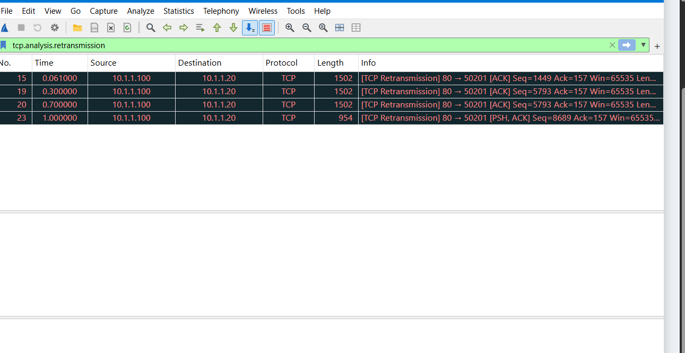
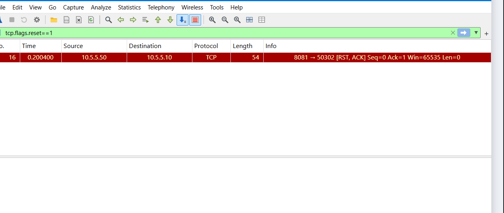

# Extra: TCP retransmissions and resets

Two short exercises in reading TCP health signals.

## Retransmissions

Filter: `tcp.analysis.retransmission`

- Four packets were flagged, all from `10.1.1.100` (port 80) to `10.1.1.20` (port 50201).
- The segment with `Seq=5793` was sent three times in total (packets 19 and 20 are flagged as retransmissions), over about 0.4 seconds.
- Retransmissions happen when the sender does not get an acknowledgement in time. Common causes are packet loss, congestion or a faulty link.

## TCP reset

Filter: `tcp.flags.reset==1`

- One packet matched: `10.5.5.50` port 8081 to `10.5.5.10` port 50302, flags `[RST, ACK]`.
- A reset ends a connection abruptly. A reset in reply to a connection attempt usually means nothing is listening on that port, or something refused the connection.
- In a SOC context, many resets from one host can show up during port scanning, so it is worth checking the pattern.
