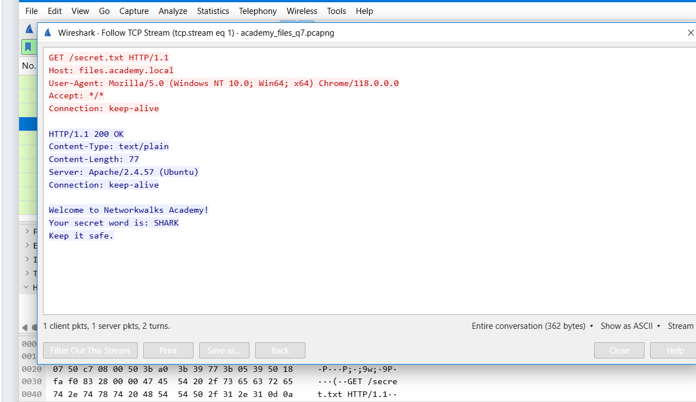

# Labs 4 and 5: Follow TCP Stream

**Goal:** rebuild a conversation between two hosts and read what was actually sent, instead of reading packets one by one.

## Steps

1. Select a packet that belongs to the conversation of interest.
2. Use **Follow, TCP Stream**. Wireshark reassembles the packets of that stream (`tcp.stream eq 1`) into readable text.
3. Read the client request (red) and the server response (blue).

## Evidence

Capture file: `academy_files_q7.pcapng`.

## What I found

- The client sent `GET /secret.txt` to the host `files.academy.local` over HTTP/1.1.
- The server (Apache/2.4.57 on Ubuntu) answered `200 OK` with `Content-Type: text/plain`.
- The body was readable plain text, including the lab's secret word.
- The stream contained 1 client packet and 1 server packet, 362 bytes in 2 turns.

## Why it matters for a SOC analyst

Individual packets rarely tell the whole story. Following the stream shows the full request and response, which helps confirm what data left a server and who asked for it. It also shows that anything sent over plain HTTP can be read by anyone who can capture the traffic.

## Lab 5

Lab 5 repeats the same technique on a new capture. Add any extra notes or screenshots here.
