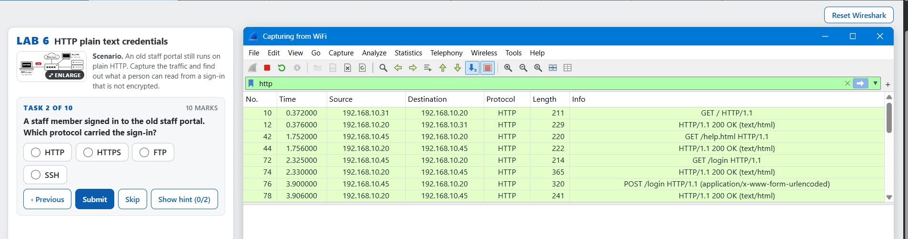
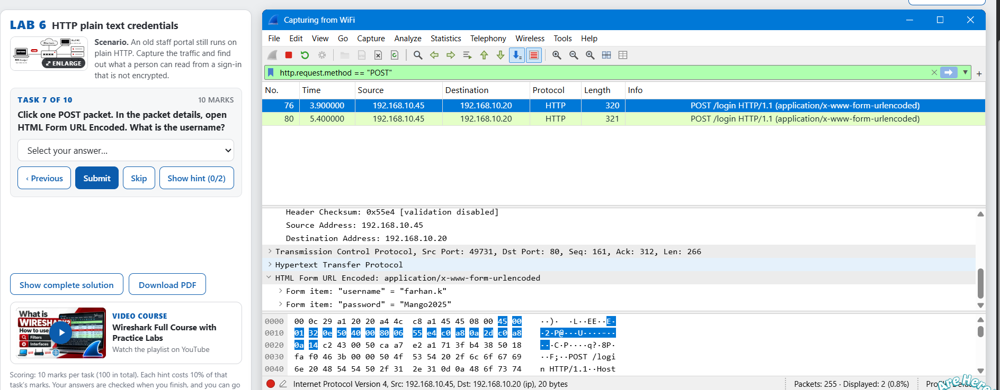
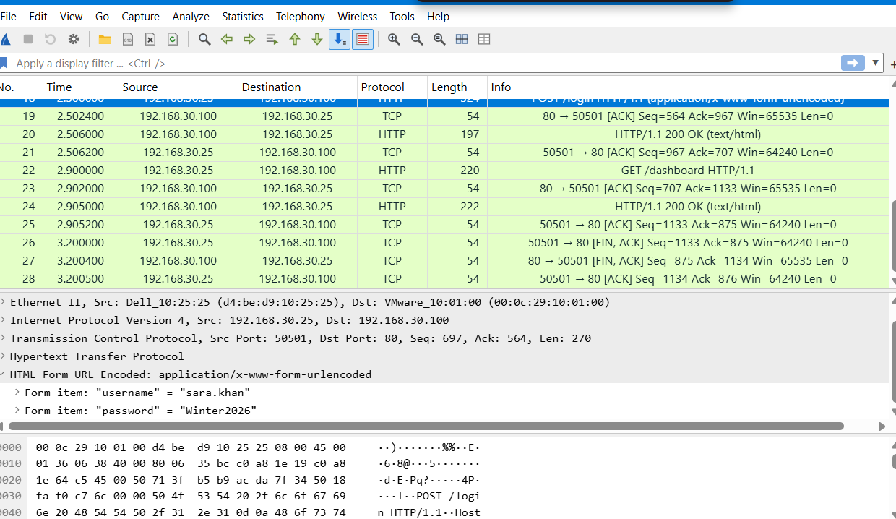

# Lab 6: HTTP plain text credentials

**Scenario:** an old staff portal still runs on plain HTTP. Capture the traffic and find what a person on the network can read from a sign-in.

## Steps

1. Filter for web traffic with `http` and read the Info column.
2. Isolate form submissions with `http.request.method == "POST"`.
3. Select a POST packet and expand **HTML Form URL Encoded** in the packet details pane.

## Evidence

**Step 1: filter HTTP traffic.** The sign-in flow is visible: `GET /login`, then `POST /login`, then `200 OK`.

**Steps 2 and 3: filter POST requests and read the form fields.** Two POST requests to `/login` were found, and the form data was readable in the packet details.

## What I found

- The protocol that carried the sign-in was **HTTP**, which is not encrypted.
- Two `POST /login` requests went from `192.168.10.45` to the portal at `192.168.10.20`.
- The form fields (username and password) were readable in clear text. These are lab-generated values.

### Another capture

A second capture shows the same weakness: a `POST /login` from `192.168.30.25` to `192.168.30.100`, followed by `200 OK` and a `GET /dashboard`. The form item `username` and `password` are again readable.

## Why it matters for a SOC analyst

Anyone on the same network path who can capture traffic can read credentials sent over HTTP. Typical recommendations:

- Serve login pages over HTTPS only.
- Redirect HTTP to HTTPS.
- Treat any credential seen in clear text as compromised and reset it.
- Add multi-factor authentication where possible.
