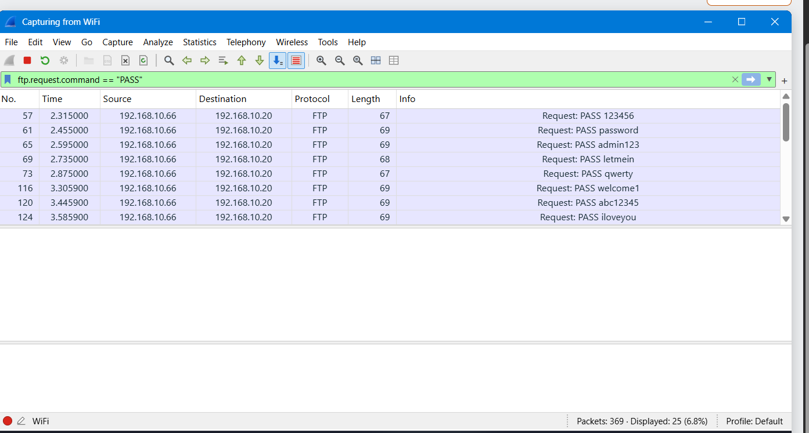

# Lab 7: Catch the brute force attacker

**Goal:** spot repeated login attempts in a capture and identify the attacker.

## Steps

1. Look for a protocol with login commands. Here: FTP.
2. Filter for password attempts with `ftp.request.command == "PASS"`.
3. Check the source and destination columns and the timing between attempts.

## Evidence

## What I found

- The filter displayed 25 of 369 packets (6.8%), all FTP `PASS` requests.
- Every attempt came from one host, `192.168.10.66`, and went to one server, `192.168.10.20`.
- Each attempt tried a different, common password (for example `123456`, `password`, `admin123`, `letmein`, `qwerty`).
- Attempts arrived about 0.14 seconds apart (for example 2.315 s, 2.455 s, 2.595 s), which is too regular and too fast for a person typing.

**Conclusion:** `192.168.10.66` is the brute-force attacker, using a password list against the FTP service.

## Indicators of brute force

| Indicator | Seen here |
|-----------|-----------|
| One source, one target | Yes |
| Many attempts in a short time | Yes |
| Evenly spaced timing | Yes |
| Common or dictionary passwords | Yes |

## Next steps to confirm impact

The screenshot shows the attempts only. To check whether any attempt succeeded, look at the server replies to the same stream (FTP response codes). A successful login would change how urgent the incident is.

## Why it matters for a SOC analyst

Repeated authentication attempts from one source are a classic alert. Common responses: block the source IP, enable account lockout or rate limiting, and move from FTP to an encrypted alternative such as SFTP or FTPS.
