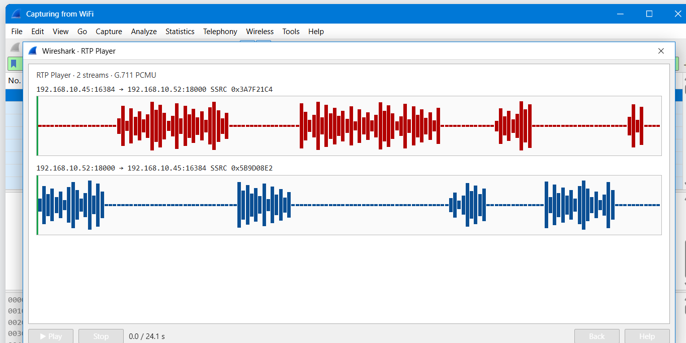

# Lab 8: Catch the call scammer

**Goal:** investigate a capture containing a phone call and identify the scammer.

## Steps

1. Open the VoIP traffic from the **Telephony** menu.
2. Open the **RTP Player** to see the audio streams in the call.
3. Review who is talking in each direction and listen to the call.

## Evidence

## What I found

- The RTP Player shows **2 streams**, one per direction, using the **G.711 PCMU** codec.
- Stream 1: `192.168.10.45:16384` to `192.168.10.52:18000` (SSRC `0x3A7F21C4`).
- Stream 2: `192.168.10.52:18000` to `192.168.10.45:16384` (SSRC `0x5B9D08E2`).
- The two waveforms take turns, which shows a two-way conversation. The recording is 24.1 seconds long.

## Identifying the scammer

_Add here which party the lab identifies as the scammer and the evidence you used (what was said, who called whom)._

## Why it matters for a SOC analyst

Network captures can contain more than web traffic. VoIP calls are carried in RTP streams that can be reassembled and replayed, which helps investigate vishing (voice phishing) and fraud.
